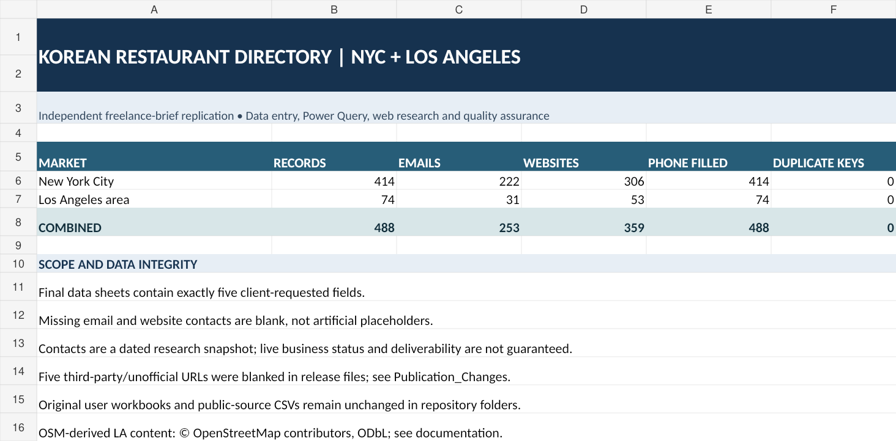
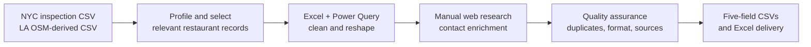
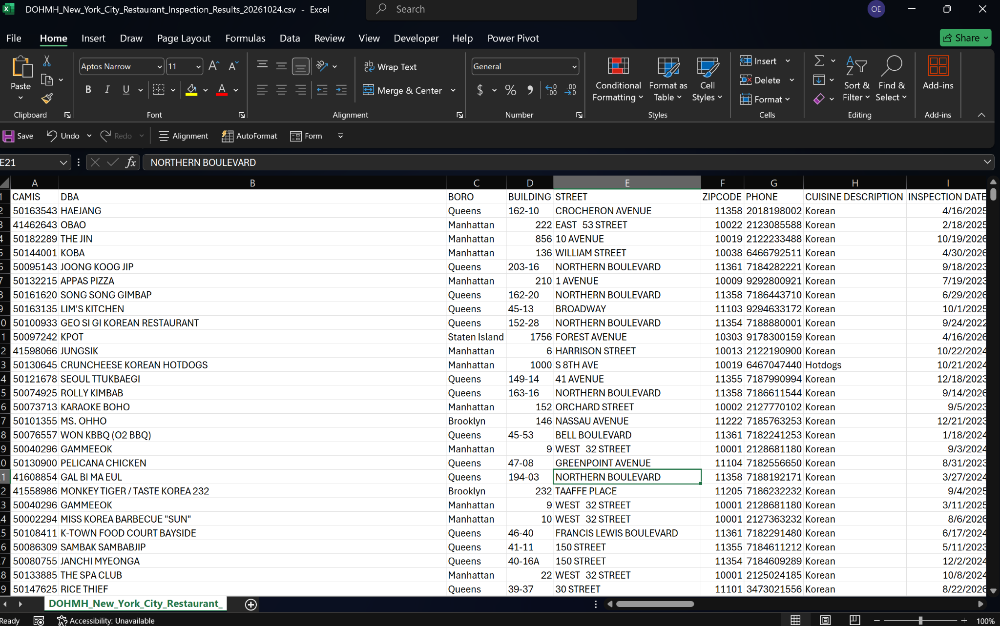
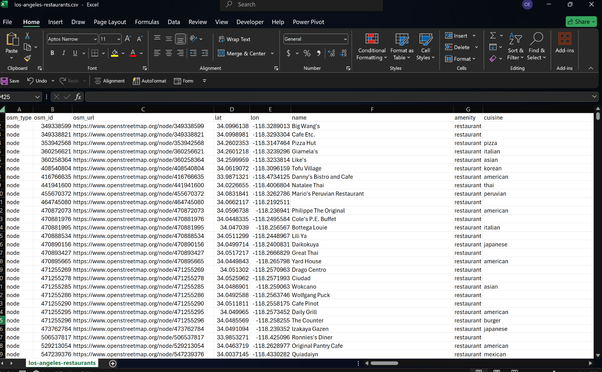
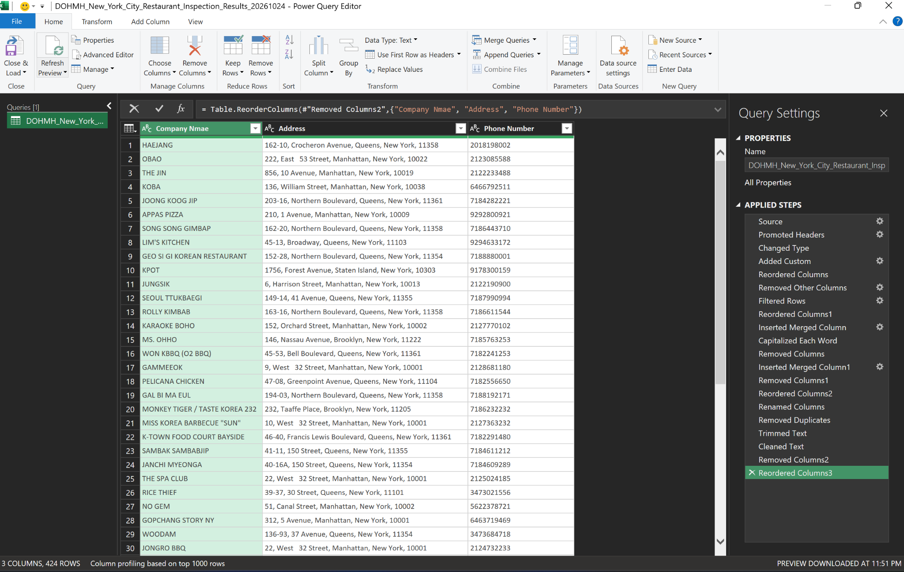
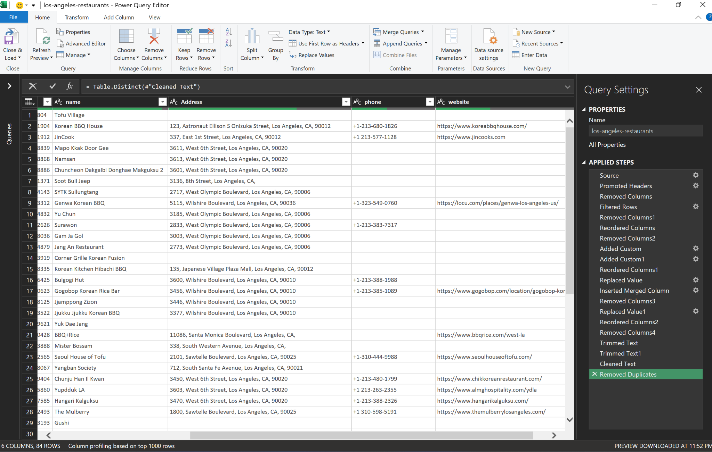
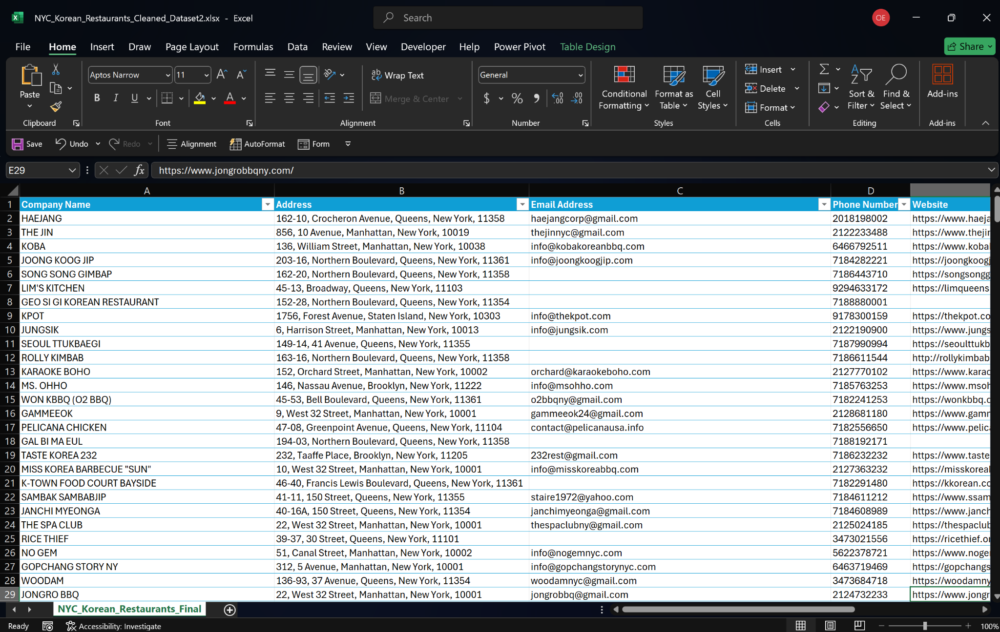
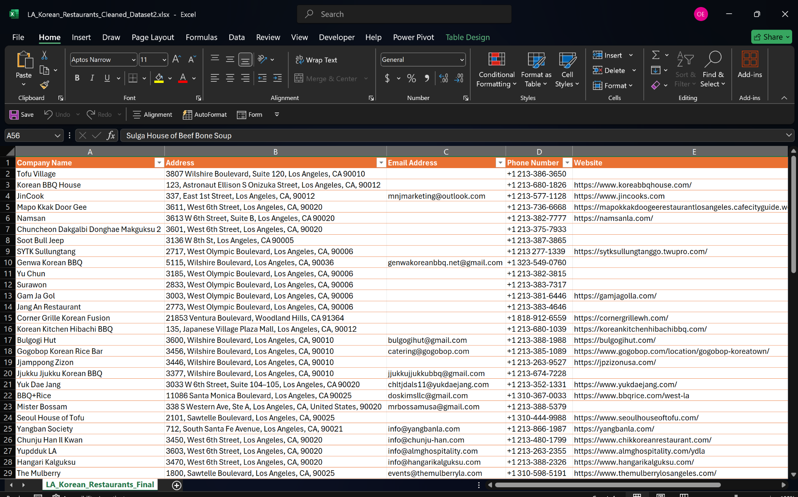

# Korean Restaurant Contact Directory | New York City & Los Angeles

**An independent, real-world data-entry, Excel/Power Query cleaning, web-research and contact-enrichment case study.**

> **Business outcome targeted:** Turn incomplete, repeated restaurant directory records into a more usable, standardized business-contact file for directory management, market research, partnership discovery and CRM preparation.

**Project type:** Self-directed replication of a publicly described freelance data-entry brief — **not a paid client engagement or an endorsed Fiverr deliverable**.  
**Geographic scope:** New York City and Greater Los Angeles-area restaurants captured in the supplied source extracts.  
**Dataset snapshot / documentation:** October 2026  
**Tools used:** Microsoft Excel, Power Query, manual web research, business websites and official social-media sources (where available).

---

## 01. The real business problem

Restaurant-contact information is rarely ready for business use as downloaded. One source may contain repeated records for the *same restaurant* because each health inspection and violation is a separate row. Another may cover thousands of restaurants across many cuisines but contain incomplete names, addresses, phone numbers, websites or emails. Identically named restaurant chains may also have different locations.

A company trying to build a Korean-restaurant contact directory for two major US markets cannot simply paste these sources into its CRM. Unresolved duplicates, inconsistent addresses, missing contacts and incorrect websites make it difficult to identify establishments, assign territories, research partners, maintain directory listings or conduct legitimate business outreach.

**The practical task was therefore to turn fragmented public records into a cleaner, five-field, restaurant-level contact deliverable** while keeping unknown values blank and documenting what still requires verification.

### Original freelance-style brief

> Gather Korean restaurants in New York and Los Angeles and collect:
> **Company Name · Address · Email Address · Phone Number · Website.**

This portfolio project replicates the **problem and deliverable requirements** of a real freelance brief, using independently obtained public source files. The original request said "all" restaurants; this release is a **curated subset of the supplied snapshots**, not a proven exhaustive census of either city.

## 02. Results — measurable data deliverables

| Metric | New York City | Los Angeles area | Combined |
|:--|--:|--:|--:|
| Curated establishment records | **414** | **74** | **488** |
| Company names populated | 414 | 74 | 488 |
| Addresses populated | 414 | 74 | 488 |
| Phone numbers populated | 414 | 74 | 488 |
| Email addresses populated | 222 | 31 | **253 (51.8%)** |
| Website URLs retained after publication checks | 306 | 53 | **359 (73.6%)** |
| Exact duplicate company-name + address pairs | 0 | 0 | **0** |
| Malformed populated email addresses (basic syntax) | 0 | 0 | **0** |
| Malformed populated website URLs (basic syntax) | 0 | 0 | **0** |

**Interpretation:** Counts measure the provided files and basic structural quality. They **do not prove** every email is active, every website is business-controlled, all phone numbers work, every establishment is open, or market coverage is exhaustive. No unmeasured ROI or lead-conversion improvement is claimed.



**Five publication checks:** I excluded five visibly third-party/unofficial website URLs from the GitHub-ready *release* copies. The user's last original Excel files remain preserved unchanged in `data/submitted_workbooks/`. See [`quality_assurance/publication_adjustments.csv`](quality_assurance/publication_adjustments.csv).

## 03. What I started with

| Original public extract | Rows in uploaded CSV | Why it needed work |
|:--|--:|:--|
| **NYC DOHMH Restaurant Inspection Results** | **4,538** | Inspection/violation-level rows, not unique businesses; **430 distinct CAMIS identifiers** in this extract; no source email or website columns |
| **Los Angeles OpenStreetMap-derived restaurant extract** | **2,904** | Citywide restaurant objects across multiple cuisines; uneven address/contact tags; **123 records with a cuisine tag containing `korean`** |

These source populations are **not directly equivalent** to the 488 final rows. Filtering, deduplication, eligibility reviews and manual research changed which establishments are represented. Because no full row-by-row identity crosswalk was supplied, this project does **not** claim that every omitted source restaurant has been individually reconciled.

- Official NYC data: [NYC Open Data — DOHMH Restaurant Inspection Results](https://data.cityofnewyork.us/Health/DOHMH-New-York-City-Restaurant-Inspection-Results/43nn-pn8j).
- LA input: OpenStreetMap-based CSV containing `osm_type`, `osm_id`, `osm_url`, coordinates, cuisine, address and optional contact tags. © OpenStreetMap contributors; [ODbL](https://www.openstreetmap.org/copyright).

## 04. Workflow: source-to-directory transformation



| Stage | Work performed | Business value |
|:--|:--|:--|
| **Source assessment** | Inspected original field structures and scoped restaurant records | Prevents treating inspection citations as separate restaurants |
| **Data preparation** | Cleaned/reshaped with Excel and Power Query; standardized field layout and addresses | Produces more consistent business records |
| **Deduplication** | Checked company name + physical address together, rather than name alone | Preserves legitimate branches while removing exact repeat entries |
| **Research and enrichment** | Manually researched publicly available addresses, phones, restaurant sites and email contacts | Improves usefulness of incomplete source records |
| **Verification triage** | Distinguished official websites from obvious third-party directory sites; left unavailable information empty | Avoids filling the deliverable with invented or misattributed contacts |
| **Quality control** | Checked nonblank key fields, email/URL syntax, phone-digit lengths and duplicate keys | Creates a traceable release assessment |

**Visual evidence:** Six authentic screenshots below show the NYC and Los Angeles source data, Power Query cleaning steps, and completed five-field Excel directories. The cleaning screenshots show *intermediate* records (424 NYC and 84 LA in the visible query previews), not the smaller, subsequently reviewed published datasets (414 NYC and 74 LA). Screenshots demonstrate the workflow but do not independently validate every business contact.

The original Excel workbooks are included so reviewers can inspect the actual Power Query connection context and manual data work. **Some query refreshes may require rebuilding source-file paths on another computer**, and manual enrichment is not fully reproducible without the original research trail.

## 05. Project workflow — screenshots from the actual work

These are genuine screen captures from the Excel and Power Query workflow. Each image links to its original full-resolution PNG in [`screenshots/`](screenshots/).

### Phase 1 — Explore the downloaded source data

| New York: inspection-level CSV | Los Angeles: OpenStreetMap-derived CSV |
|:--|:--|
| [](screenshots/01_nyc_original_csv.png) | [](screenshots/02_la_original_csv.png) |
| Repeated inspection observations require establishment-level interpretation. | Restaurant objects span multiple cuisines and contain uneven contact fields. |

### Phase 2 — Transform and standardize in Power Query

| New York: query transformations | Los Angeles: query transformations |
|:--|:--|
| [](screenshots/03_nyc_power_query_cleaning.png) | [](screenshots/04_la_power_query_cleaning.png) |
| Applied steps show column selection, reordering, trimming, cleaning and deduplication. | Applied steps show source filtering, column operations, custom transformations and deduplication. |

### Phase 3 — Manually enrich and deliver the five-field files

| New York: enriched directory | Los Angeles: enriched directory |
|:--|:--|
| [](screenshots/05_nyc_final_directory.png) | [](screenshots/06_la_final_directory.png) |
| A standardized directory including business contacts where available. | Same client-required five-field structure for the LA market. |

> **Evidence note:** The screenshots are documentation of actual workflow stages, not proof that every contact is current or official. Intermediate query previews have different row counts from the final released directories because further manual research and review followed. Full-resolution images and descriptions are indexed in [`documentation/SCREENSHOT_EVIDENCE.md`](documentation/SCREENSHOT_EVIDENCE.md).

## 06. Concrete source-to-final examples

**New York — HAEJANG:** The downloaded inspection extract contains multiple records for the same restaurant (CAMIS `50163543`). It includes the restaurant name, street and phone but has **no email or website fields**. The final directory adds `haejangcorp@gmail.com` and `https://www.haejang.com/` to the standardized business entry. This demonstrates contact-field enrichment, not independently audited current deliverability.

**Los Angeles — Namsan:** In the input OSM extract (node `2165018868`), the phone, email and website tags are blank. The final directory contains a phone number and `https://namsanla.com/`, reflecting manual completion of the source record.

These two comparisons are documented in [`quality_assurance/source_to_final_examples.csv`](quality_assurance/source_to_final_examples.csv).

## 07. Files and navigation

```text
korean_restaurant_directory_portfolio/
├── README.md
├── assets/                    Portfolio overview image
├── screenshots/               Six authentic workflow screenshots (01–06)
├── data/
│   ├── raw/                      Original downloaded CSV snapshots
│   ├── submitted_workbooks/      User's unchanged final Excel workbooks
│   └── final/
│       ├── nyc_korean_restaurants.csv
│       ├── la_korean_restaurants.csv
│       ├── korean_restaurants_combined.csv
│       └── Korean_Restaurant_Directory_Portfolio.xlsx
├── quality_assurance/
│   ├── quality_metrics.csv
│   ├── publication_adjustments.csv
│   ├── manual_review_queue.csv
│   ├── source_to_final_examples.csv
│   └── verification_log_TEMPLATE.csv
└── documentation/
    ├── PROJECT_BRIEF.md
    ├── METHODOLOGY.md
    ├── DATA_DICTIONARY.md
    ├── QUALITY_ASSURANCE.md
    ├── SCREENSHOT_EVIDENCE.md
    ├── SOURCES_AND_ATTRIBUTION.md
    ├── CHANGELOG.md
    └── GITHUB_UPLOAD_GUIDE.md
```

**Quick review:** Open `data/final/Korean_Restaurant_Directory_Portfolio.xlsx` or the two city CSVs. The delivered business data keeps **exactly the client's five required columns**; source/verification metadata are kept separately.

## 08. Data-quality decisions

- **Blank is meaningful:** Missing email and website cells are intentionally blank — no fake `"N/A"` strings or made-up contacts.
- **Validation is not verification:** A syntactically valid email is not proof that it belongs to the restaurant or that it is deliverable.
- **Location matters:** The same chain name may legitimately occur at multiple street addresses.
- **Historical businesses exist:** Some records may be closed, renamed or relocated. Check the [`manual review queue`](quality_assurance/manual_review_queue.csv) before treating the directory as a current active-business list.
- **No blanket completeness claim:** The released file is a curated public-source snapshot, not every Korean restaurant in both markets.
- **No proof of commercial impact:** Reduced research effort, better directory operations and outreach preparation are *intended use cases*, not measured customer results.

A source-by-source log of every contact check was not supplied with the finished spreadsheets. The [`verification log template`](quality_assurance/verification_log_TEMPLATE.csv) supports a future defensible audit. Until completed, do not describe all 253 email addresses or 359 websites as independently verified current contacts.

## 09. Skills demonstrated

**Data Entry & Data Operations** · **Excel** · **Power Query** · **Data Cleaning & Transformation** · **Business Directory Research** · **Manual Data Enrichment** · **Record Deduplication** · **Data Quality Assurance** · **Structured CSV/XLSX Delivery** · **Source Attribution**

This is an **operations deliverable**, not a predictive analytics or dashboard project. It emphasizes data accuracy, research judgment and handoff readiness for practical business use.

## 10. Ethical use, provenance and attribution

Only publicly available business-contact information should be used; avoid unauthorized access, private personal information, unsolicited outreach in violation of applicable rules, and false claims of contact verification.

- NYC source: [NYC Open Data / Department of Health and Mental Hygiene](https://data.cityofnewyork.us/Health/DOHMH-New-York-City-Restaurant-Inspection-Results/43nn-pn8j).
- LA source: **© OpenStreetMap contributors**, licensed under the **Open Database License (ODbL)**. Details and reuse conditions: [openstreetmap.org/copyright](https://www.openstreetmap.org/copyright).
- See [`documentation/SOURCES_AND_ATTRIBUTION.md`](documentation/SOURCES_AND_ATTRIBUTION.md) before republishing or relicensing the database. Do not assume a single blanket MIT license applies to third-party data.

---

**Portfolio positioning:** An independently executed, realistic demonstration of how public restaurant records can be collected, standardized, enriched and quality-checked into a usable five-field business directory.
